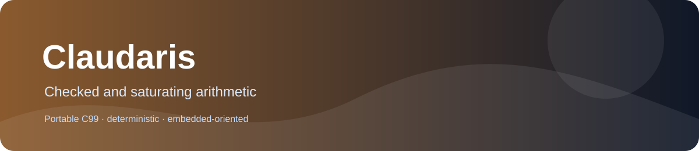

# Claudaris
  



Checked arithmetic, saturation, ratios, ranges, alignment and time conversion.

## Why it exists

Embedded safety-critical calculations need explicit overflow status and predictable saturation.

## What is included

- Portable C99-oriented implementation.
- Deterministic integer or fixed-point behavior documented at function level.
- No mandatory heap, threads or operating-system services.
- Separate translation units for selective linking.

## Quick start

```sh
cmake -S . -B build -DCLAUDARIS_BUILD_TESTS=ON
cmake --build build --parallel
ctest --test-dir build --output-on-failure
```

For a minimal integration, include only the required public header and compile the matching source unit. The library does not require the rest of PrimitiveCore.

## Documentation

| Need | Read |
|---|---|
| Choose a primitive | [Family guide](docs/FAMILY_GUIDE.md) |
| Check every function and contract | [API reference](docs/API_REFERENCE.md) |
| Reproduce tests and see validation limits | [Testing report](docs/TESTING.md) |
| Review design and dependencies | [Architecture](docs/ARCHITECTURE.md) |
| See measured or pending performance data | [Performance](docs/PERFORMANCE.md) |

## At a glance

The public surface consists of **46 callable APIs in 46 public headers** under `include/`. The time-ratio implementation uses one private helper declared in `src/pc_time_ratio_internal.h`; it is not public. The 47 C source units are 46 public implementations plus that shared internal helper. Automated validation is provided by 43 CTest programs. State, buffers and output ownership are explicit in each public header contract.

The CMake test option is CLAUDARIS_BUILD_TESTS. The library has no mandatory third-party dependency. Platform-specific link requirements are documented in CMake and the affected API header.

## Validation status

The audit test suite directly exercises 46/46 public APIs, including deterministic boundary checks and seeded differential tests. The current audit matrix and hardware status are recorded in [docs/AUDIT.md](docs/AUDIT.md) and [docs/TESTING.md](docs/TESTING.md). ESP32-S3 validation for all APIs remains `HW NOT VERIFIED` until a safe, task-authorized board can be identified.

Detailed overflow, rounding, invalid-input, memory-ownership and state rules are defined by the public headers and API reference. Do not infer them from the product name alone.

## License

Apache License 2.0, copyright Vanderhell. See [LICENSE](LICENSE) and [NOTICE](NOTICE).

## Origin

A standalone embedded-C library extracted from the PrimitiveCore product catalog. It is independently buildable and linkable.
